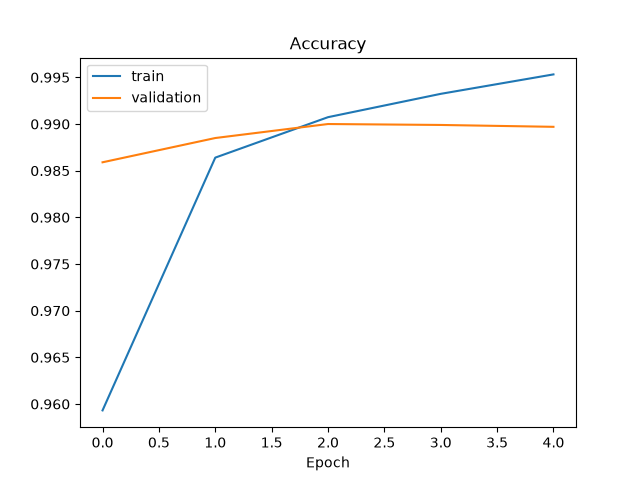

<div align="center">

# ✍️ Handwritten Digit Recognizer

**Draw a digit with your mouse. A neural network tells you what it is.**


</div>

---

## ✨ Features

- 🖊️ **Draw freely** on a black canvas with a white pen
- 🧠 **CNN trained on MNIST** (60,000 handwritten digits)
- ⚡ **Instant prediction** with a confidence percentage
- 🧹 **One-click Clear** to try again
- 🪶 **Small, readable code**: two Python files, no extras

---

## 📁 Project Structure

| File | What it does |
|------|--------------|
| `train_model.py` | Builds, trains and saves the CNN |
| `digit_recognizer_gui.py` | Tkinter app: draw, preprocess, predict |
| `mnist_cnn_model.keras` | The saved, trained model |
| `training_curves.png` | Accuracy graph from training |
| `requirements.txt` | Python dependencies |

---

## 🚀 Getting Started

### 1. Install

```bash
python3.12 -m venv .venv
source .venv/bin/activate
pip install -r requirements.txt
```

> 💡 On macOS, the drawing window needs Tk: `brew install python-tk@3.12`

### 2. Train the model

```bash
python train_model.py
```

This downloads MNIST automatically, trains for 5 epochs and saves `mnist_cnn_model.keras`.

### 3. Run the app

```bash
python digit_recognizer_gui.py
```

Draw a digit, press **Predict**, press **Clear** to start over.

---

## 🧠 The Model

A small Convolutional Neural Network (CNN):

```
Input (28×28 grayscale image)
   ↓
Conv2D (32 filters) → MaxPooling     ← finds simple patterns like edges
   ↓
Conv2D (64 filters) → MaxPooling     ← finds shapes like curves and loops
   ↓
Flatten → Dense (128)                ← combines the features
   ↓
Dense (10, softmax)                  ← one probability per digit 0-9
```

### 📈 Training Results

<div align="center">

</div>

Training and validation accuracy rise together and level off near 99%, which means the model learns well without simply memorizing the training data.

---

## 🔍 How It Works

```
 ✏️ Draw  →  ✂️ Crop  →  📐 Resize 20×20  →  🎯 Center in 28×28  →  🧠 CNN  →  🔢 Digit
```

1. **Draw**: strokes appear on the canvas and are copied onto a hidden image.
2. **Crop**: the image is cut down to the digit's bounding box.
3. **Resize**: the digit is made square and shrunk to 20×20.
4. **Center**: it is placed in the middle of a 28×28 image, the same format as MNIST.
5. **Predict**: the CNN outputs 10 probabilities, and the highest one is the answer.

---

## 💡 Tips for Best Results

- Draw the digit **large and centered**, like writing on a whiteboard
- Use **one clear stroke style**; very thin or tiny digits are harder to read
- Press **Clear** between digits

---

## 🛠️ Built With

- [TensorFlow / Keras](https://www.tensorflow.org/): model
- [Pillow](https://python-pillow.org/): image processing
- [NumPy](https://numpy.org/): array handling
- [Matplotlib](https://matplotlib.org/): training graph
- [Tkinter](https://docs.python.org/3/library/tkinter.html): desktop GUI

---

<div align="center">

⭐ If you found this project useful, give it a star!

</div>
